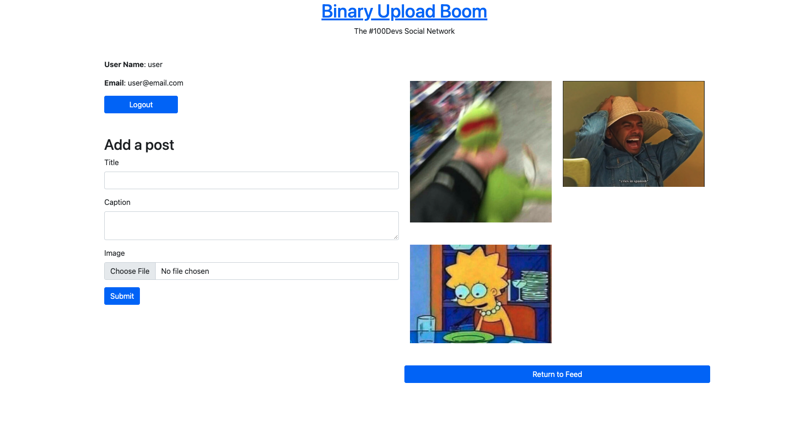

# Social Network

A full-stack social network where users sign up, log in and share image posts. Each post has a title, a caption and an uploaded photo, and other users can browse the feed and like posts.

[Try out Social Network here!]()

## Preview



## Features

- Sign up and log in with an email and password
- Passwords are hashed before they are saved
- Profile page that shows your account info and your own posts
- You can upload an image post with a title and a caption
- The site feed shows posts from all users, in order of newest first
- Users can like a post and delete their own posts

## Built With

- HTML, CSS and JavaScript
- Node.js and Express
- EJS templates
- MongoDB and Mongoose
- Passport authentication
- Multer and Cloudinary for image uploads

## How to Install & Use

1. Clone repo
2. Run `npm install`
3. Create a `.env` file in the `config` folder and add the following as `key = value`:

```
- `PORT` = 2121 (can be any port, for example 3000)
- `DB_STRING` = your MongoDB connection string
- `CLOUD_NAME` = your Cloudinary cloud name
- `API_KEY` = your Cloudinary API key
- `API_SECRET` = your Cloudinary API secret
```

4. Run `npm start`
5. Navigate to `localhost:` followed by the port you chose, for example `localhost:2121`

## What I Learned

- Site architecture & organizing app into models, views, controllers and routes
- Relating data in MongoDB with Mongoose, such as posts that belong to a user
- Uploading images with Multer and storing them with Cloudinary
- Keeping users logged in with stored sessions in MongoDB
- Keeping secrets like database strings and API keys out of the code with the `.env` file
- Reusing parts of a page, like the header and footer, with EJS partials
